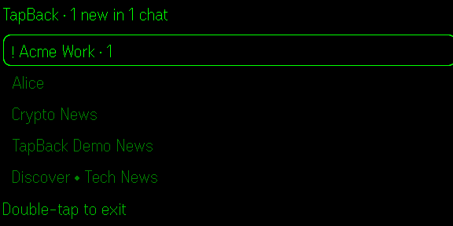
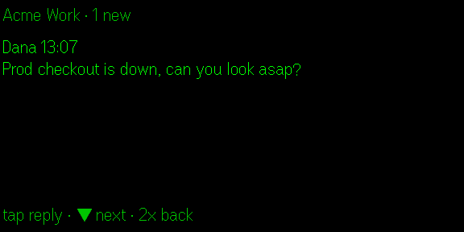
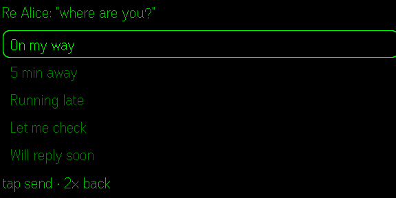
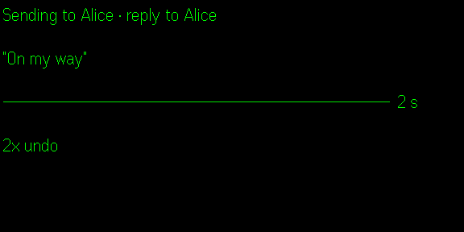
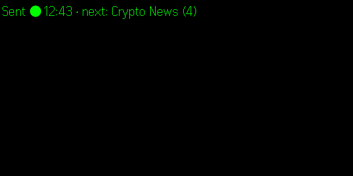
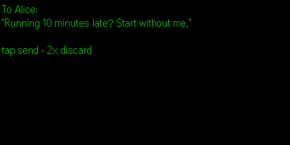
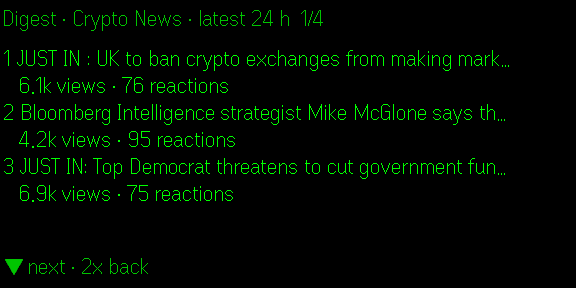
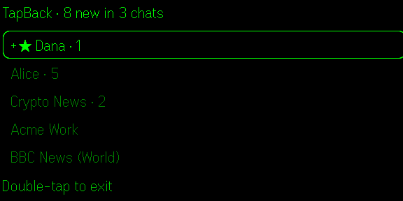
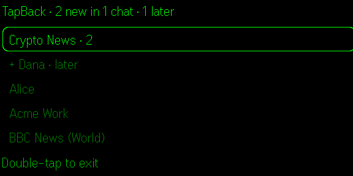
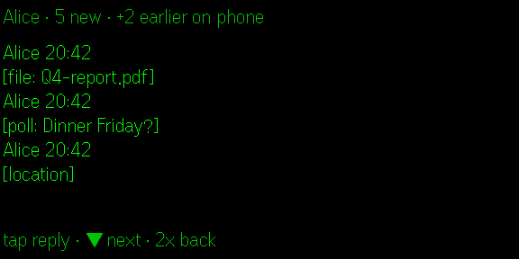

# TapBack

[](https://github.com/samizdatproject/tapback/actions/workflows/test.yml)

**Telegram triage for Even G2 smart glasses. An unofficial Telegram client that uses the Telegram API.**

TapBack shows the Telegram chats you pick, one card at a time, on the G2 display. If you turn it on, a VIP or an @mention from a chat you didn't pick can come through too. You answer with two taps from rule-based reply suggestions, or hold to dictate a reply. A 30-second digest shows the top posts of the channels you follow.

Built for the [Heads Up: Even Realities hackathon](https://dorahacks.io/hackathon/even-realities/detail) (Nov 23–29, 2026), track 01 · Messaging & News.

**▶ [Watch the demo video](https://samizdatproject.github.io/tapback/tapback-demo.mp4)** (72 s, captions only; file: [`docs/tapback-demo.mp4`](docs/tapback-demo.mp4)). Recorded in one take: the Even Hub simulator on the left, Telegram Desktop on the same real account on the right, with demo chats.

## On the glasses

Real screens from the Even Hub simulator (576×288), running against a real Telegram account with demo chats.

| | |
|---|---|
|  |  |
| **Inbox.** The chats you picked. `!` marks a mention or an urgent word, and those come first. `+` marks a chat you didn't pick that came through (opt-in); `· later` marks a chat kept unread for later. | **Card.** The newest 1–3 messages. Shown means read, as Telegram's rules require. Media shows as a label, such as `[voice 0:14]` or `[photo]` followed by the caption. |
|  |  |
| **Quick replies.** "Where are you?" gets "On my way"; a meeting time gets "Works for me". Rules, not AI. | **Undo.** Every send waits 2 seconds. Double-tap, or opening the menu, cancels it. |
|  |  |
| **Sent.** Then the next chat with unread messages opens. | **Hold to talk.** Transcribed by whisper.cpp on your own machine. You confirm before it sends. |
|  |  |
| **Digest.** The top 3 posts per channel by views, reactions and forwards, first line verbatim. Each channel's sponsored message follows on its own page. | **Breakthrough (opt-in).** Dana isn't a picked chat, but she's a VIP, so her message gets through with `+`. @mentions in groups work the same way. |
|  |  |
| **Later.** Glanced but can't answer? "Later: keep unread" marks the chat unread in Telegram, so it still looks unread on your phone. | **Media.** Voice notes, photos, files, polls and locations say what they are: `[voice 0:14]`, `[photo] caption`, `[file: Q4-report.pdf]`. |

## How it works

```
G2 glasses ──BLE── Even Realities app (WebView: TapBack plugin, Vite + TypeScript + Even Hub SDK)
                        │  HTTP + WebSocket to your own backend (pairing code, device token)
                        ▼
               TapBack backend (Python: FastAPI + Telethon), on your own machine
                 ├─ Telegram user client (your own api_id): picked chats, plus opt-in breakthrough
                 ├─ deterministic reply rules and digest ranking (no AI on Telegram data)
                 └─ whisper.cpp server on the same machine for dictation
```

- **Pick what matters.** On the phone screen you tick the chats and channels that matter. Nothing else reaches the glasses unless you turn on breakthrough (see "Your rules"). Archived chats are never offered or shown.
- **Glance, tap, tap.** A new message from a picked chat shows as a card. Opening it marks it read, as Telegram's rules require (no "ghost mode"). One tap opens reply suggestions; a second tap sends after a 2-second undo window.
- **Later.** Glanced but can't answer now? "Later" in the card menu marks the chat unread with Telegram's own "Mark as unread", so it also looks unread on your phone, and the next chat opens (during quiet hours, the inbox). Later chats are listed after unread ones. A picked chat you mark unread on the phone shows as later on the glasses, and opening its card clears the mark. TapBack stores nothing for this; the mark lives in Telegram.
- **Media.** Voice notes, videos, photos and files show as short labels: `[voice 0:14]`, `[video message 0:09]`, `[photo]` plus the caption, `[file: name.pdf]`, `[poll: question]`. Voice notes are not transcribed.
- **Hold to talk.** Dictation goes to whisper.cpp on your own machine. You see the transcript and confirm before anything is sent.
- **Digest.** The top 3 new posts per picked channel, ranked by views, reactions and forwards, shown verbatim. Telegram's sponsored messages are shown where Telegram returns them.
- **Your rules.** VIP senders get `★`, your urgent words get `!`, and both come first. Quiet hours turn the glasses into counts only. Reply suggestions you pick most in a chat move to the top there (only counts of your own choices are kept, never message text). Breakthrough (off by default) lets two kinds of chat you didn't pick through while they have unread messages: a private chat with one of your VIPs, and a group that @mentions you. They get `+` and can be opened and answered like picked chats. Channels never come through, and your mutes and snoozes still apply.

## Who it's for, and the path to launch

**Users.** People whose work runs through a few Telegram chats inside a big, noisy account: crypto traders and fund teams, founders, community and support managers, on-call engineers. Telegram is where much of crypto and a large part of the tech world coordinates, and these users already pay for tools that save them attention.

**Why they'd switch from the phone.** The phone shows everything; TapBack shows only what they picked (plus, if they opt in, VIPs and @mentions), and a reply takes two taps without looking down. No AI touches their messages, which matters to exactly these users (deal flow, trading, ops).

**Path to launch on Even Hub.**
1. **Now:** an Even Hub plugin plus a one-command self-hosted backend (`scripts/run-local.sh`), for technical users and teams who run their own servers.
2. **Next:** an optional hosted backend, one isolated instance per user (their own encrypted session, no shared message store), as a paid subscription for people who won't self-host. The plugin stays free.
3. **Then:** Slack and Discord through the same card and reply engine (both are in the same track's app list), so one glanceable inbox covers a person's work chats.

**Why it can ship.** It follows Telegram's API terms by design (own api_id, "unofficial" naming, read receipts honoured, sponsored messages shown, no AI on Telegram data), so it can be listed without depending on rules being loosened later.

## Privacy and Telegram's terms

- **No Telegram data goes to any AI service.** Reply suggestions come from published regex rules ([`backend/tapback/rules.py`](backend/tapback/rules.py)); the digest ranks by metadata and shows each post's own first line. Voice notes show as `[voice 0:14]` and are never transcribed; only your own dictated replies go to speech-to-text.
- **Self-hosted.** The backend runs on your machine. The Telegram session is stored only encrypted (AES-256-GCM), with the key in a separate file.
- **No message storage.** Message text stays in memory; the database holds only picked chat ids, hashed device tokens and mute timers. Logs never contain message text.
- **Read receipts honoured, every send undoable.** Replies go only to chats you picked, or to a chat that came through by breakthrough, at most 10 a minute. The server checks breakthrough on Telegram itself and never takes the glasses' word for it.
- **Sponsored messages** are fetched as Telegram requires, cached for 5 minutes and reported as viewed only when shown. The glasses can't open links, so the button label is shown as plain text.
- TapBack is not affiliated with Telegram. It uses its own api_id, as Telegram's API terms require.

## Setup (developer preview)

Requirements: Python 3.11+, Node 22.13+, a Telegram api_id/api_hash from [my.telegram.org](https://my.telegram.org), and [whisper.cpp](https://github.com/ggml-org/whisper.cpp) for dictation.

```bash
# 1. backend
cd backend
python3 -m venv .venv && .venv/bin/pip install -r requirements.txt
mkdir -p -m 700 ~/.config/tapback        # secrets live outside the repo
cat > ~/.config/tapback/tapback.env <<'EOF'
TG_API_ID=123456
TG_API_HASH=your_api_hash
EOF
export TAPBACK_ENV=~/.config/tapback/tapback.env
.venv/bin/python -m tapback login   # phone, code, 2FA in your terminal
.venv/bin/python -m tapback serve   # prints a 6-digit pairing code

# 2. speech-to-text (optional)
whisper-server -m models/ggml-base.en.bin --host 127.0.0.1 --port 8080

# 3. plugin
cd ../plugin && npm install && npm run dev
# then run the Even Hub simulator against http://localhost:5173 (see plugin/README.md)
```

Pair on the phone screen with the code the backend printed, pick your chats, and press Save.
Or start everything at once with `scripts/run-local.sh`.

A packaged plugin (`tapback.ehpk`, built with `npm run pack`) is attached to the [v0.1.0 release](https://github.com/samizdatproject/tapback/releases/tag/v0.1.0). It whitelists `localhost:8787`; for real glasses, add your TLS origin to `plugin/app.json` and re-pack.

### On real glasses

In the simulator the plugin reaches the backend at `localhost`. On a phone, `localhost` is the phone, so the backend needs an HTTPS address the phone can reach. **Don't expose it over plain HTTP**: the device token, messages and audio would cross the network unencrypted. Put it behind TLS, for example `tailscale serve 8787` on a tailnet your phone is on, or a reverse proxy such as Caddy on a VPS, and add that `https://` and `wss://` origin to the `network` whitelist in `plugin/app.json`.

The device token is as powerful as the backend itself, so pair only your own phone. **Log out & wipe** on the phone screen ends the Telegram session (`auth.logOut`), deletes the encrypted session and forgets every paired device.

## What existed before Nov 23

Before the hackathon (Nov 23, 08:00 UTC) there were research and design notes only: screen sketches, the reply rules and the architecture. We ran a throwaway copy of the official `minimal` template to learn how the simulator delivers taps and swipes, then deleted it. We also registered a Telegram api_id and built whisper.cpp locally. **No TapBack code existed. All code in this repository was written from Nov 23, 2026.**

**Third-party code:** Even Hub SDK and templates (MIT), Telethon, FastAPI, uvicorn, cryptography, httpx, whisper.cpp, Vite, TypeScript and vitest, all under their own licenses.

**How it was built:** with AI coding assistance (Claude), disclosed here. TapBack itself sends no Telegram data to any AI service.

## License

MIT
